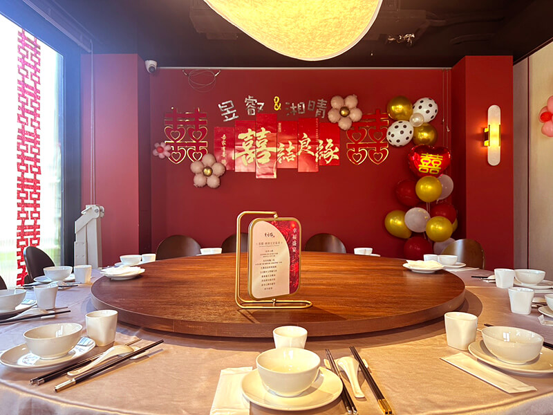
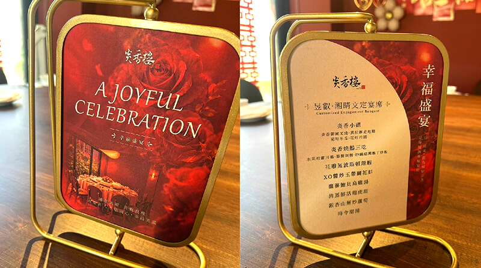

### 人數不剛好是 10 人、預算有上限、長輩有特殊的飲食習慣，或是想把夢寐以求的米其林級經典大菜、主廚隱藏版手路菜一次放進私房宴席中？制式套餐常常很難面面俱到。坐落於台中西區的炎香樓粵式料理提供「私人訂製桌宴」。店內所有菜品皆可依人數、預算與宴會需求由專人協助配置，從精緻冷盤、頂級熱菜、生猛海鮮、老火湯品到主食、甜品，量身搭出一席恰到好處的頂級粵菜私宴。

### 特別的是，在私人訂製桌宴中，您更能指定由米其林星級主廚 葉志光師傅與亞洲御廚 曾鏡雄師傅掌勺演繹的傳世名菜，讓國際級大師手藝為您的私房宴席畫龍點睛：

## 文章目錄

* 【炎香樓粵式料理｜訂製桌宴重點整理】
* 【炎香樓粵式料理｜為什麼選擇訂製桌宴？米其林與亞洲御廚的極致工藝】
* 【炎香樓粵式料理｜老饕必點隱藏名菜：蜜瓜爵士湯、沙母蚧炒糯米飯與脆皮海鮮冬瓜盅】
* 【炎香樓粵式料理｜訂製桌宴流程】
* 【炎香樓粵式料理｜桌宴怎麼配？文定、結婚、家宴與商務宴客指南】
* 【炎香樓粵式料理｜訂製桌宴與現成方案怎麼選？】
* 【炎香樓粵式料理｜停車優惠】
* 【炎香樓粵式料理｜訂位資訊】
* 【炎香樓粵式料理｜常見問題 FAQ】

##### \-——————————

## [【炎香樓粵式料理｜訂製桌宴重點整理】](https://www.youtube.com/shorts/wjZIap__5N0)

* 服務內容： 私人訂製桌宴（客製專屬桌宴、文定宴、結婚宴、家宴）   
* 配菜彈性： 店內所有菜品（含老饕私房與隱藏名菜）皆可依人數、預算、宴會需求協助配置。   
* 預約方式： 採預約制，需提前 3～5 天預約，由專人搭配合適的菜色與桌宴組合。   
* 席次規格： 一樓提供 4 至 10 人客席；二樓設有三間高隱密性獨立包廂，適合 10 人以上宴席並提供客製餐宴。   
* 價位參考： 訂製桌宴依實際配置而定。   
* 地址： 台中市西區精誠八街12巷2號   
* 預約專線： (04)2329-9968 

\-——————————

## 【炎香樓粵式料理｜為什麼選擇訂製桌宴？米其林與亞洲御廚的極致工藝】

在講究品味與儀式感的現代餐飲中，制式菜單往往無法完全滿足重要時刻的獨特需求。選擇炎香樓的私人訂製桌宴，享有四大核心優勢：

1. 人數有彈性： 依實際出席人數精準配置菜量，不必為湊足固定人數而煩惱。   
2. 預算好掌握： 先告知預算範圍，由專人在預算內搭配出最高性價比的頂級菜色與精緻份量。   
3. 場合量身規劃： 無論是浪漫喜氣的文定宴、隆重溫馨的結婚宴、講究圓滿孝心的三代同堂家宴，或是重視體面與上菜節奏的商務宴請、氣氛熱絡的尾牙春酒，皆能完美對應。   
4. 大師級手藝加持： 炎香樓由世界廚神陳偉強領軍五星級主廚團隊，更不定期客座與匯聚國際名廚，如亞洲御廚曾鏡雄師傅的頂級拿手絕活，將國際米其林級的粵菜工藝完美呈現於您的私房餐桌上。   

\-——————————

## 【炎香樓粵式料理｜老饕必點隱藏名菜：[蜜瓜爵士湯、沙母蚧炒糯米飯與脆皮海鮮冬瓜盅】](https://www.youtube.com/shorts/PR2UY4b93Xc)

除了常態菜單外，炎香樓針對高端私人訂製私宴，特別推出老饕口耳相傳的神級隱藏預訂料理與大師拿手絕活。\
大師匠心手藝：米其林星級主廚與亞洲御廚的極致代表作

在炎香樓的訂製桌宴中，最令饕客津津樂道的，便是由國際頂尖名廚坐鎮演繹的傳世經典。每一道菜品皆凝鍊了數十年的粵菜功力與對食材的至高追求，讓您的宴席排場與驚豔度瞬間升級：

• 港式宮廷名湯[【蜜瓜爵士湯】](https://www.youtube.com/shorts/PR2UY4b93Xc)：匯聚 11 樣稀珍食材慢火精燉的傳奇粵式煲湯！嚴選清甜多汁的哈密瓜，搭配頂級花膠筒、乾螺頭、瑤柱等珍貴海味乾貨同熬，湯頭集結了海味的極致鮮醇與蜜瓜的天然果甜，清潤甘美、膠質豐厚。上桌前服務人員更會先為賓客展示稀珍乾貨食材，儀式感滿分，是高端商務宴請與孝敬長輩的頂級滋補首選。 

• 【沙母蚧炒糯米飯】：嚴選膏滿肉肥的生猛沙母，搭配吸滿濃郁蟹黃精華與主廚特調醬汁的Ｑ彈糯米飯一同大火翻炒。沙母的鮮甜完美滲入每一顆米粒之中，鑊氣十足、奢華感爆表，展現國際級米其林水準的粵菜功力，更是文定、結婚與重要宴席象徵「富貴圓滿」的壓軸主食。

• 粵式工藝極致濃湯[【脆皮海鮮冬瓜盅】](https://www.youtube.com/shorts/PR2UY4b93Xc)：由享譽國際的「全球義廚」、被譽為亞洲御廚的曾鏡雄師傅親自傳承指導的頂級名菜！考驗主廚深厚刀工與火候的經典懷舊手工菜。將整顆冬瓜巧妙去蕪存菁，外層輕炸至金黃微脆鎖住清甜，盅內則慢火燉入菌菇、頂級蟹肉、鮮帶子與鮮蝦粒等山珍海味。上桌時由服務人員於桌邊挖取冬瓜肉與鮮湯同盛，脆皮香氣、清甜瓜肉與濃郁海鮮湯汁在口中完美交融，層次極為豐富驚豔。

\-——————————

## [【炎香樓粵式料理｜訂製桌宴流程】](https://www.youtube.com/shorts/wjZIap__5N0)

1. 告知宴席需求： 預先提供用餐日期、時段、預計人數、預算範圍、宴會場合（如文定宴、結婚宴、家宴或商務宴請），以及賓客的飲食禁忌。   
2. 專人建議搭配： 專業團隊依據您的需求，從店內經典粵菜、海鮮、私房功夫菜及隱藏名菜中量身規劃桌宴組合。   
3. 確認菜單與價格： 與專人深入溝通、微調細節後，最終確認專屬宴席內容與價格。   
4. 完成預約： 訂製桌宴採預約制，需提前 3～5 天完成預約。   
5. 當日尊榮入席： 依約抵達，位席已為您備妥極致款待。   

   ※ 實際流程、訂金與取消規定，請以專人說明為準。   

\-——————————

## 【炎香樓粵式料理｜桌宴怎麼配？文定、結婚、家宴與商務宴請指南】

溫潤的【脆皮冬瓜盅】、清爽時蔬、經典粵菜，兼顧軟嫩與長輩的養生需求。   

選用鮑、參、花膠等珍饈，搭配二樓隱密獨立包廂，由專人提供管家式服務。   

以合菜桌宴為基礎，依人數與桌數彈性調整，兼顧面子與裡子。   

以功夫菜、精緻港點與生猛海鮮為主，搭配單點或 4-8 人精選分享餐。   

※ 以上為配置方向示意，實際菜色皆可由專人依您的預算與需求量身建議。   

## [【炎香樓粵式料理｜桌宴怎麼配？文定、結婚、家宴與商務宴請指南】](https://www.youtube.com/shorts/wjZIap__5N0)

•  文定宴 / 結婚宴：喜氣、體面、象徵圓滿、賓主盡歡\
結合隱藏料理[【火焰脆皮雞】](https://www.youtube.com/shorts/0U1MLFwQdnM)象徵起家、頂級大菜如【沙母蚧炒糯米飯】象徵富貴，搭配獨立包廂與頂級海味。

•  家庭聚餐 / 圓滿家宴：口味老少咸宜、滋補暖心、份量充足\
溫潤的[【脆皮冬瓜盅】](https://www.youtube.com/shorts/PR2UY4b93Xc)清爽時蔬、經典粵菜，兼顧軟嫩與長輩的養生需求。

•  商務宴請 / 貴賓款待：尊榮、隱密、上菜節奏流暢、展現誠意\
選用鮑、參、花膠等珍饈，搭配二樓隱密獨立包廂，由專人提供管家式服務。

•  公司聚餐 / 尾牙春酒：菜色澎湃、氣氛熱絡、預算好控制\
以合菜桌宴為基礎，依人數與桌數彈性調整，兼顧面子與裡子。

•  朋友聚餐 / 慶祝派對：輕鬆分享、招牌必吃、氛圍歡愉\
以功夫菜、精緻港點與生猛海鮮為主，搭配單點或 4-8 人精選分享餐。

※ 以上為配置方向示意，實際菜色皆可由專人依您的預算與需求量身建議。 

\-——————————

## 【炎香樓粵式料理｜價位參考】

* 現有標準桌宴方案(2026年方案參考)：

  * 尾牙聚福＆春酒賀歲桌宴：NT$19,800／25,800／32,800
  * 炎香巨籠宴：NT$21,800／28,800／38,800（另加 10% 服務費）   
* 私人訂製專屬私宴：

  * 參考範例價格約 NT$32,800～38,800（10位）起   
  * 實際價格依您挑選的頂級食材（如吉品鮑、花膠、波龍、沙母、隱藏版火焰脆皮雞等）與人數配置而定，歡迎預約時向專人諮詢規劃。 
  *

\-——————————

## 【炎香樓粵式料理｜訂製桌宴與現成方案怎麼選？】

* 選擇現成桌宴方案： 適合想快速決定、省去配菜時間，且對標準菜單滿意的客群（如炎香巨籠宴、節慶春節桌宴等）。   
* 選擇私人訂製桌宴： 適合舉辦文定宴、結婚宴、重要家宴，或對人數、預算、特定隱藏料理（如火焰脆皮雞、沙母蚧炒糯米飯）有高度要求的貴賓。   

\-——————————

## 【炎香樓粵式料理｜停車優惠】

炎香樓位在台中西區精誠路靜巷內，周邊巷道停車較為不便，建議將車輛停放於鄰近的立體停車場再步行前往。來店用餐可享[東興立體停車場](https://share.google/LzDRtKblreISakg0O)免費停車 2 小時的便利優惠，從停車場步行至店約 6 分鐘（約 400 公尺）。

\-——————————

## 【炎香樓粵式料理｜訂位資訊】

◎介紹店鋪：炎香樓粵式料理｜台中西區\
◎地址：403 台中市西區公平里精誠八街12巷2號\
◎預約專線：(04)2329-9968\
◎[LINE 官方帳號：@mew1122i](https://lin.ee/stJ0XuH)\
◎營業時間：11:00～14:00／17:00～21:00（21:30閉店)\
◎預約規定：訂製桌宴採預約制，需提前3～5天預約\
◎消費提醒：包廂席次有限，建議提早預約\
[◎官方網站：https://yanxianglou.com.tw/](https://yanxianglou.com.tw/)\
[◎菜單參考：https://yanxianglou.com.tw/menu-set.html](https://yanxianglou.com.tw/menu-set.html)

\-——————————

## 【炎香樓粵式料理｜常見問題 FAQ】

### Q：私人訂製桌宴該怎麼安排？

A：訂製桌宴採預約制，需提前3～5天預約，可依宴請需求、人數及預算量身規劃，由專人為您搭配合適的菜色與桌宴組合。

### Q：店內哪些菜可以拿來訂製？

A：店內所有菜品都可以依人數、預算與宴會需求，由專人協助配置。

### Q：訂製桌宴需要幾個人？

A：可依實際人數配置。席次方面，一樓提供4至10人客席，二樓設有三間獨立包廂，適合10人以上宴席。

### Q：訂製桌宴大概多少錢？

A：價格依人數與菜色配置而定。現有10人桌宴方案約 NT$19,800～38,800，可作為預算參考；請在預約時告知預算，由專人協助搭配。

### Q：需要提前多久預約？

A：需提前3～5天預約；人數較多或需要包廂，建議更早洽詢。

### Q：可以指定包廂嗎？

A：二樓設有三間獨立包廂，包廂席次有限，建議提早預約，以利安排。

### Q：酒水可以自帶嗎？

A：酒水與開瓶費規定請於預約時向專人確認；炎香巨籠宴方案標示自帶酒水酌收開瓶費 NT$500。

### Q：有港式飲茶或吃到飽嗎？

A：沒有。炎香樓主打傳統粵菜，提供精緻特色功夫菜、單點、宴客桌菜與客製專屬桌宴。

### Q：炎香樓附近好停車嗎？

A：巷弄內不好停車，建議停在附近東興立體停車場步行前往。可享用餐免費停車2小時、步行約6分鐘。

\-——————————

## 延伸閱讀

• 炎香樓巨籠宴\
• [炎香樓海粵小巨籠](https://yanxianglou.com.tw/news/hai-yue-xiao-ju-long/)\
• [炎香樓尾牙春酒桌宴](https://yanxianglou.com.tw/news/%E5%B0%BE%E7%89%99-%E6%98%A5%E9%85%92-%E5%A5%BD%E5%AE%B4%E9%96%8B%E5%B8%AD/)\
• [炎香樓2027春節桌宴](https://yanxianglou.com.tw/news/%E7%82%8E%E9%A6%99%E6%A8%93%E7%B2%B5%E5%BC%8F%E6%96%99%E7%90%86-%E5%8F%B0%E4%B8%AD%E6%98%A5%E7%AF%80%E5%9C%8D%E7%88%90%E6%8E%A8%E8%96%A6-2027%E7%BE%8A%E5%B9%B4%E6%A1%8C%E5%AE%B4-%E7%A6%8F%E7%BE%8A%E8%BF%8E%E6%98%A5%E6%B5%B7%E9%99%B8%E5%AE%B4-%E7%91%9E%E7%BE%8A%E5%91%88%E7%A5%A5%E9%BE%8D%E9%B3%B3%E5%AE%B4-6%E4%BA%BA10%E4%BA%BA%E5%B8%AD%E5%8A%A0%E5%A4%96%E5%B8%B6%E5%B9%B4%E8%8F%9C%E5%A5%97%E7%B5%84/)
