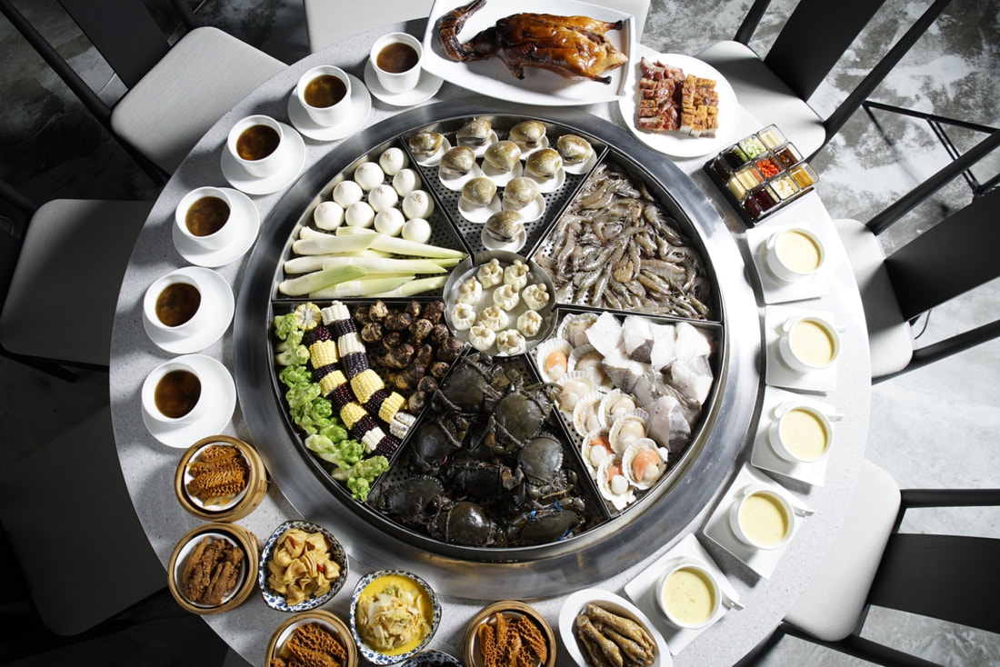

##### 蒸籠揭蓋的瞬間，鮮香四溢、豪氣佳餚盡現眼前，這就是炎香樓粵式料理最具代表性的「巨籠宴」。炎香樓位於台中西區精誠八街巷弄，引進全台首座直徑超過 1 米的大轉輪蒸籠，2026 年 6 月更新方案共有三款 10 人桌宴：NT$21,800、NT$28,800、NT$38,800（均另加 10% 服務費），從龍虎斑、南非鮑、紅蟳，到果木窯烤片皮鴨三吃、蒜蓉蒸龍蝦與活帝王蟹，可依預算與場合選擇。人數超過 10 人可加量、加價，適合家庭聚餐、朋友聚餐、公司聚餐與包廂宴客。

##### \-——————————

## 文章目錄

* 【炎香樓粵式料理｜巨籠宴重點整理】
* 【炎香樓粵式料理｜為什麼推薦巨籠宴？】
* 【炎香樓粵式料理｜三款巨籠宴價格一覽】
* 【炎香樓粵式料理｜巨籠宴 NT$21,800 方案】
* 【炎香樓粵式料理｜巨籠宴 NT$28,800 方案】
* 【炎香樓粵式料理｜巨籠宴 NT$38,800 方案】
* 【炎香樓粵式料理｜加量、酒水與海鮮更換規則】
* 【炎香樓粵式料理｜怎麼選？】
* 【炎香樓粵式料理｜停車優惠】
* 【炎香樓粵式料理｜訂位資訊】
* 【炎香樓粵式料理｜常見問題 FAQ】

##### \-——————————

## 【炎香樓粵式料理｜巨籠宴重點整理】

* 方案名稱：炎香巨籠宴（2026年6月更新方案）
* 價格：NT$21,800／NT$28,800／NT$38,800，皆為10人份，另加10%服務費
* 最低訂餐量：10人份，人數較多可加量、加價
* 酒水：酒水冷飲、服務費另計；自帶酒水酌收開瓶費 NT$500
* 海鮮：因季節或供貨問題，餐廳保留更換權力，服務人員會於點餐前告知
* 空間：一樓4至10人客席，二樓三間獨立包廂
* 地址：台中市西區精誠八街12巷2號
* 預約專線：(04)2329-9968

## 【炎香樓粵式料理｜為什麼推薦巨籠宴？】

炎香樓由世界廚神陳偉強領軍五星級主廚團隊，於 2017 年元月 21 日重裝登場，匯聚主廚私房頂級料理與經典粵式風味。店內引進全台首座大轉輪蒸籠，直徑超過 1 米，可容納生猛海鮮、山產鮮蔬與珍味美饌，蒸籠揭蓋的瞬間鮮香四溢，是兼具視覺與味覺的饗宴，也是許多人心中的台中巨籠宴代表。

空間融合中式古典與現代雅緻，一樓提供 4 至 10 人客席，二樓設有三間獨立包廂，適合 10 人以上宴席。無論是三代同堂的家庭聚餐、宴請貴賓的商務聚餐，或是公司尾牙春酒，都能找到適合的席位。

##### \-——————————

## 【炎香樓粵式料理｜三款巨籠宴價格一覽】

10人桌價方案（另加10%服務費）

• NT$21,800 方案 | 每位平均約 NT$2,180\
海鮮與主菜亮點：龍虎斑、南非鮑、草蝦、蒜蓉扇貝、紅蟳；經典火焰脆皮雞

• NT$28,800 方案 | 每位平均約 NT$2,880\
海鮮與主菜亮點：手臂蝦、龍虎斑、松露干貝、紅蟳、蒜蓉蒸龍蝦；果木窯烤片皮鴨三吃

• NT$38,800 方案 | 每位平均約 NT$3,880\
海鮮與主菜亮點：泰國蝦公母（各半）、龍虎斑、紅蟳10隻、活帝王蟹2kg；果木窯烤片皮鴨三吃

※ 平均每位為依桌價計算的參考數字，實際以現場結帳為準。

##### \-——————————

## 【炎香樓粵式料理｜巨籠宴 NT$21,800 方案】

* 炎香御膳三品：陳醋海蜇、紫蘇葡萄冬瓜、梅汁蕃茄
* **[經典火焰脆皮雞](https://www.youtube.com/shorts/0U1MLFwQdnM)**
* 蝦兵蟹將：龍虎斑、南非鮑、草蝦、蒜蓉扇貝、紅蟳
* 炎香港點：粉蒸排骨
* 珍菌蒔蔬：甜玉米、紫地瓜、娃娃菜、蛤蜊絲瓜
* 川粵江南品味：碧綠松阪豬
* 黑蒜瑪卡雞湯
* 四季寶島時令鮮果

適合：預算友善的家庭聚餐、朋友聚餐與部門聚餐。龍虎斑、南非鮑、草蝦、扇貝與紅蟳一次到齊，是入門巨籠宴最划算的選擇。

## 【炎香樓粵式料理｜巨籠宴 NT$28,800 方案】

* 炎香御膳三品：陳醋海蜇、香辣口水雞、梅汁蕃茄
* 果木窯烤片皮鴨三吃：傳統片皮鴨、片鴨握壽司、鴨粥
* 蝦兵蟹將：手臂蝦、龍虎斑、松露干貝、紅蟳、蒜蓉蒸龍蝦
* 炎香港點：粉蒸排骨
* 珍菌蒔蔬：甜玉米、紫地瓜、娃娃菜、蛤蜊絲瓜
* 川粵江南品味：碧綠松阪蘭花蚌／川椒牛小排（2選1）
* 蔘棗鮑貝烏雞湯
* 四季寶島時令鮮果

適合：重要家宴、公司聚餐與尾牙春酒。片皮鴨三吃加上蒜蓉蒸龍蝦，餐桌更有宴席的氣勢。

## 【炎香樓粵式料理｜巨籠宴 NT$38,800 方案】

* 炎香御膳三品：陳醋海蜇、黑松露走地雞、梅汁蕃茄
* 果木窯烤片皮鴨三吃：傳統片皮鴨、片鴨握壽司、鴨粥
* 蝦兵蟹將：泰國蝦公母（各半）、龍虎斑、蒜蓉蒸貝、紅蟳10隻、活帝王蟹2kg
* 炎香港點：粉蒸排骨
* 珍菌蒔蔬：甜玉米、紫地瓜、娃娃菜、蛤蜊絲瓜
* 川粵江南品味：碧綠松阪蘭花蚌／川椒牛小排（2選1）
* 蔘棗鮑貝烏雞湯
* 四季寶島時令鮮果

適合：宴請貴賓、重要客戶與高規格慶祝。活帝王蟹2kg與紅蟳10隻上桌，視覺與份量都很有話題。

\-——————————

## 【炎香樓粵式料理｜加量、酒水與海鮮更換規則】

•       人數：桌菜基礎本菜量為10人份，多人可加量、加價，實際價格請於預約時向專人確認。

•       服務費：桌價另加10%服務費。

•       酒水冷飲：酒水冷飲、服務費需另計。

•       自帶酒水：需酌收開瓶費 NT$500。

•       海鮮更換：海鮮因季節或供貨問題，餐廳保留更換權力，服務人員將於點餐前告知。

\-——————————

## 【炎香樓粵式料理｜怎麼選？】

•       家庭聚餐、朋友聚餐：選 NT$21,800 方案，龍虎斑、南非鮑、草蝦、扇貝與紅蟳都有，CP值高。

•       公司聚餐、尾牙春酒：選 NT$28,800 方案，片皮鴨三吃與蒜蓉蒸龍蝦，份量與氣氛兼具。

•       宴請貴賓、重要客戶：選 NT$38,800 方案，活帝王蟹2kg與紅蟳10隻，場面十足。

•       人數不到10人：可選擇**[「海粵小巨籠」](https://yanxianglou.com.tw/news/hai-yue-xiao-ju-long/)**4人宴席（海味四喜 NT$5,880、極鮮御宴 NT$11,880，另加10%服務費），4人也能體驗蒸籠宴。

•       想調整菜色、預算或人數：炎香樓提供**[「私人訂製桌宴」](https://yanxianglou.com.tw/news/%E6%AF%8F%E4%B8%80%E6%A1%8C-%E9%83%BD%E6%98%AF%E5%B0%88%E5%B1%AC%E8%A8%82%E8%A3%BD/)**，店內菜品可依人數、預算與宴會需求由專人協助配置。

\-——————————

## 【炎香樓粵式料理｜停車優惠】

炎香樓位在精誠路巷弄內，附近巷道不好停車，建議把車停在附近的**[東興立體停車場](https://share.google/7Uw43oiJHddeUmKMY)**再步行前往。用餐可享東興立體停車場免費停車2小時，從停車場步行到店約6分鐘（約400公尺）。

\-——————————

## 【炎香樓粵式料理｜訂位資訊】

◎介紹店鋪：炎香樓粵式料理｜台中西區\
◎地址：403 台中市西區公平里精誠八街12巷2號\
◎預約專線：(04)2329-9968\
◎LINE 官方帳號：@mew1122i\
◎營業時間：11:00～14:00／17:00～21:30\
◎方案：炎香巨籠宴（2026年6月更新方案），10人份起\
◎消費提醒：務必事先預約訂位，並於預約時確認當日海鮮供應\
◎官方網站：https://yanxianglou.com.tw/\
◎菜單參考：https://yanxianglou.com.tw/menu-set.html

\-——————————

## 【炎香樓粵式料理｜常見問題 FAQ】

### Q：炎香樓巨籠宴多少錢？

A：共三款，皆為10人份，另加10%服務費：NT$21,800、NT$28,800、NT$38,800。

### Q：巨籠宴最少要幾個人？

A：桌菜基礎本菜量為10人份，也就是最低訂餐量為10人份；人數較多可加量、加價。

### Q：4個人也可以吃巨籠宴嗎？

A：可以。炎香樓推出「海粵小巨籠」4人宴席，海味四喜 NT$5,880、極鮮御宴 NT$11,880（另加10%服務費），極鮮御宴需提前3日預訂。

### Q：人數超過10人怎麼算？

A：可加量、加價，實際金額請於預約時向專人確認。

### Q：酒水要另外算嗎？可以自帶酒嗎？

A：酒水冷飲與服務費需另計；自帶酒水需酌收開瓶費 NT$500。

### Q：海鮮可以更換嗎？

A：海鮮因季節或供貨問題，餐廳保留更換權力，服務人員將於點餐前告知。

### Q：可以客製菜色嗎？

A：可以。炎香樓提供私人訂製桌宴，可依人數、預算與宴會需求由專人協助配置，需提前3～5天預約。

### Q：炎香樓有包廂嗎？

A：二樓設有三間獨立包廂，適合10人以上宴席；包廂席次有限，建議提早預約。

### Q：炎香樓附近好停車嗎？

A：巷弄內不好停車，建議停在附近立體停車場步行前往。據部落客分享，東興立體停車場可享用餐免費停車2小時、步行約6分鐘，實際優惠請向店家確認。

\-——————————

## 延伸閱讀

* [炎香樓海粵小巨籠](https://yanxianglou.com.tw/news/hai-yue-xiao-ju-long/)
* [炎香樓私人訂製宴席](https://yanxianglou.com.tw/news/%E6%AF%8F%E4%B8%80%E6%A1%8C-%E9%83%BD%E6%98%AF%E5%B0%88%E5%B1%AC%E8%A8%82%E8%A3%BD/)
* [炎香樓尾牙春酒桌宴](https://yanxianglou.com.tw/news/%E5%B0%BE%E7%89%99-%E6%98%A5%E9%85%92-%E5%A5%BD%E5%AE%B4%E9%96%8B%E5%B8%AD/)
* [炎香樓2027春節桌宴](https://yanxianglou.com.tw/news/%E7%82%8E%E9%A6%99%E6%A8%93%E7%B2%B5%E5%BC%8F%E6%96%99%E7%90%86-%E5%8F%B0%E4%B8%AD%E6%98%A5%E7%AF%80%E5%9C%8D%E7%88%90%E6%8E%A8%E8%96%A6-2027%E7%BE%8A%E5%B9%B4%E6%A1%8C%E5%AE%B4-%E7%A6%8F%E7%BE%8A%E8%BF%8E%E6%98%A5%E6%B5%B7%E9%99%B8%E5%AE%B4-%E7%91%9E%E7%BE%8A%E5%91%88%E7%A5%A5%E9%BE%8D%E9%B3%B3%E5%AE%B4-6%E4%BA%BA10%E4%BA%BA%E5%B8%AD%E5%8A%A0%E5%A4%96%E5%B8%B6%E5%B9%B4%E8%8F%9C%E5%A5%97%E7%B5%84/)
* [炎香樓2027春節外帶套組](https://yanxianglou.com.tw/news/%E7%82%8E%E9%A6%99%E6%A8%93%E7%B2%B5%E5%BC%8F%E6%96%99%E7%90%86-%E5%8F%B0%E4%B8%AD%E5%A4%96%E5%B8%B6%E5%B9%B4%E8%8F%9C%E6%8E%A8%E8%96%A6-2027%E7%BE%8A%E5%B9%B4%E8%A1%8C%E5%A4%A7%E9%81%8B10%E4%BA%BA%E4%BB%BD%E5%B9%B4%E8%8F%9C%E5%A5%97%E7%B5%84-%E8%B6%85%E6%97%A9%E9%B3%A5%E5%8A%A0%E8%B4%8822%E9%BB%9E-%E9%99%A4%E5%A4%95%E7%8F%BE%E5%81%9A%E7%86%B1%E8%8F%9C/)
