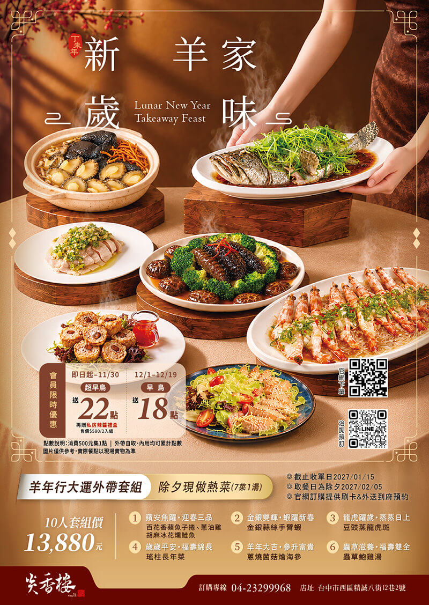
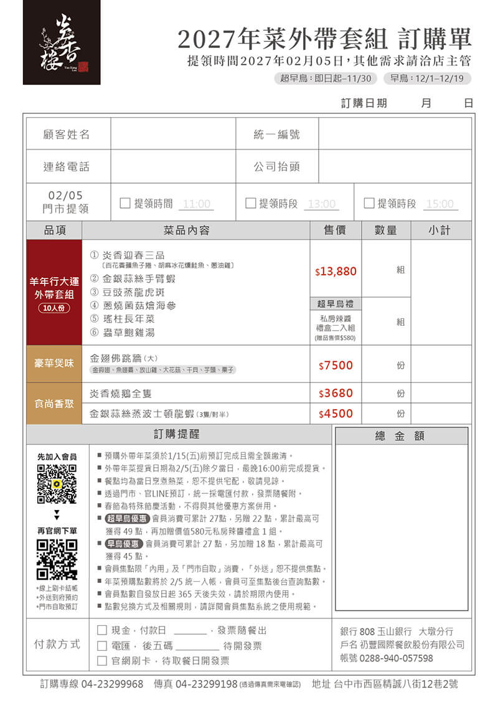

今年想在家圍爐，又不想自己備料煮一整桌？台中西區的炎香樓粵式料理，由世界廚神陳偉強領軍五星級主廚團隊，推出「2027羊年行大運外帶年菜套組」，10人份 NT$13,880，內容為7菜1湯，除夕當天現做熱菜，取餐日為2027/02/05 除夕。即日起至 11/30 的「超早鳥」訂購，除了原價購買，還可加贈會員22點與私房辣醬禮盒二入組；訂購方式提供門市、官方LINE、電話與官網下單，官網並提供刷卡與外送到府預約。

##### \-——————————

## 文章目錄

• 【炎香樓粵式料理｜外帶年菜重點整理】\
• 【炎香樓粵式料理｜羊年行大運外帶套組內容】\
• 【炎香樓粵式料理｜單點加購】\
• 【炎香樓粵式料理｜超早鳥與早鳥優惠】\
• 【炎香樓粵式料理｜會員點數累計辦法】\
• 【炎香樓粵式料理｜訂購流程】\
• 【炎香樓粵式料理｜付款方式與發票】\
• 【炎香樓粵式料理｜取餐方式：門市自取與外送到府】\
• 【炎香樓粵式料理｜停車優惠】\
• 【炎香樓粵式料理｜訂購資訊】\
• 【炎香樓粵式料理｜常見問題 FAQ】

##### \-——————————

## 【炎香樓粵式料理｜外帶年菜重點整理】

• 套組名稱：羊年行大運外帶套組（10人份）

• 套組價格：NT$13,880，平均每位約 NT$1,388

• 內容：除夕現做熱菜，7菜1湯

• 取餐日：2027/02/05（五）除夕當天

• 截止收單日：2027/01/15（五），並需全額繳清

• 超早鳥：即日起～11/30，加贈會員22點，再贈私房辣醬禮盒二入組（售價 NT$580）

• 早鳥：12/1～12/19，加贈會員18點

• 訂購管道：門市、[官方LINE](https://lin.ee/6iuln3J)、電話、[官網下單](https://yanxianglou.oddle.me/zh_TW)

• [官網下單：https://yanxianglou.oddle.me/zh_TW](https://yanxianglou.oddle.me/zh_TW)（提供刷卡與外送到府預約）

##### \-——————————

## 【炎香樓粵式料理｜羊年行大運外帶套組內容】

套組共6個品項，其中「炎香迎春三品」包含3款冷盤，合計7菜1湯，每道都取了吉祥的菜名：

1.蘋安魚躍・迎春三品：百花香蘋魚子捲、蔥油雞、胡麻冰花燻鮭魚

2.金銀雙輝・蝦躍新春：金銀蒜絲手臂蝦

3.龍虎躍歲・蒸蒸日上：豆豉蒸龍虎斑

4.歲歲平安・福壽綿長：瑤柱長年菜

5.羊年大吉・參升富貴：蔥燒菌菇燴海參

6.蟲草滋養・福壽雙全：蟲草鮑雞湯

餐點均為當日烹煮的熱菜，所以取餐當天的新鮮度與溫度都是賣點，也因此不提供宅配。

##### \-——————————

## 【炎香樓粵式料理｜單點加購】

想讓年夜飯桌面更豐盛，訂購單上另有加購品項：

• 炎香燒鵝NT$3,680

• 金銀蒜絲蒸波龍 | NT$4,500
（3隻/對半）

• 金翅佛跳牆 | NT$7,500
（金鉤翅、魚翅唇、放山雞、干貝、芋頭、栗子、大花菇

\-——————————

## 【炎香樓粵式料理｜超早鳥與早鳥優惠】

炎香樓這次的年菜早鳥優惠不打折，而是以會員點數與禮盒回饋，原價購買即可累計：

☑超早鳥 | 即日起～11/30\
會員消費可累計27點，另贈22點，累計最高49點；再加贈價值 NT$580 的私房辣醬禮盒二入組

☑早鳥 | 12/1～12/19\
會員消費可累計27點，另加贈18點，累計最高45點

※ 春節為特殊節慶活動，不得與其他優惠方案併用。

##### \-——————————

## 【炎香樓粵式料理｜會員點數累計辦法】

• 累點方式：消費滿500元集1點。

• 適用範圍：內用與門市自取皆可累點；外送恕不提供集點。

• 年菜點數入帳：預購點數將於 2/5 統一入帳，會員可至集點後台查詢。

• 點數效期：自發放日起365天後失效，請於期限內使用。

• [入會方式：先加入炎香樓會員，再下單](https://api.ocard.co/lineauth/yanxianglou)。

• 兌換規則：詳見會員集點系統的使用規範。

##### \-——————————

## 【炎香樓粵式料理｜訂購流程】

1. 先加入會員：掃描QR Code加入炎香樓會員，才能累計點數。

2. 選擇訂購管道：[官網下單](https://yanxianglou.oddle.me/zh_TW)、門市、[官方LINE（@mew1122i）](https://lin.ee/6iuln3J)或電話 04-2329-9968。

3. 填寫訂購單：包含顧客姓名、連絡電話，需要統一編號與公司抬頭的客戶也請一併填寫。

4. 選擇取餐時段與取餐方式：門市自取 或 外送到府。

5. 完成付款：須於 2027/01/15（五）前完成預訂並全額繳清。

6. 除夕當天取餐或收餐：享用當日現做的熱菜。

##### \-——————————

## 【炎香樓粵式料理｜付款方式與發票】

• 透過門市、官方LINE預訂：統一採電匯付款，發票隨餐附。

• 訂購單上的付款選項：現金（填寫付款日，發票隨出）、電匯（填寫匯款後五碼，待開發票）、官網刷卡（待取餐日開發票）。

• 官網下單：提供線上刷卡結帳。

• 匯款帳號等資訊，請依訂購單或專人提供為準。

##### \-——————————

## 【炎香樓粵式料理｜取餐方式：門市自取與外送到府】

### 門市自取

• 取餐日：2027/02/05（五）除夕當天。

• 取餐時段：11:00、13:00、15:00，最晚 16:00 前完成提貨。

• 取餐地點：台中市西區精誠八街12巷2號。

• 其他需求：請洽店主管。

### 🚘官網預約外送到府

• 於官網下單頁面選擇外送到府預約，並可線上刷卡結帳。

• 外送費用與送達時段，請以官網下單頁面為準。

• 外送訂單恕不提供會員集點。

##### \-——————————

## 【炎香樓粵式料理｜停車優惠】

炎香樓位在精誠路巷弄內，附近巷道不好停車，門市自取建議停在附近立體停車場再步行前往。據部落客實地分享，用餐可享東興立體停車場免費停車2小時，步行約6分鐘（約400公尺）。實際優惠與使用方式，請於訂購時向店家確認；年菜取餐日車流較多，建議預留時間。

##### \-——————————

## 【炎香樓粵式料理｜訂購資訊】

◎介紹店鋪：炎香樓粵式料理｜台中西區

◎地址：403 台中市西區公平里精誠八街12巷2號

◎訂購專線：04-2329-9968

◎傳真：04-2329-9198（透過傳真需來電確認）

◎[LINE 官方帳號：@mew1122i](https://lin.ee/6iuln3J)

◎營業時間：11:00～14:00／17:00～21:30

◎截止收單：2027/01/15（五）

◎取餐日：2027/02/05（五）除夕

◎[官方網站：https://yanxianglou.com.tw/](https://yanxianglou.com.tw/)

◎[外帶訂餐：https://yanxianglou.oddle.me/zh_TW](https://yanxianglou.oddle.me/zh_TW)

##### \-——————————

## 【炎香樓粵式料理｜常見問題 FAQ】

### Q：炎香樓的外帶年菜套組多少錢？內容是什麼？

A：羊年行大運外帶套組為10人份 NT$13,880，內容為7菜1湯：炎香迎春三品（百花香蘋魚子捲、蔥油雞、胡麻冰花燻鮭魚）、金銀蒜絲手臂蝦、豆豉蒸龍虎斑、蔥燒菌菇燴海參、瑤柱長年菜、蟲草鮑雞湯。

### Q：什麼時候取餐？

A：取餐日為2027/02/05 除夕當天，門市自取時段為 11:00、13:00、15:00，最晚16:00前完成提貨。

### Q：最晚什麼時候要訂？

A：截止收單日為2027/01/15，須在此日前預訂並全額繳清。

### Q：超早鳥與早鳥有什麼優惠？

A：原價購買，不打折。超早鳥（即日起～11/30）加贈會員22點，再贈 NT$580 私房辣醬禮盒二入組；早鳥（12/1～12/19）加贈會員18點。

### Q：會員點數怎麼算？

A：消費500元集1點，內用與門市自取可累點，外送不集點。年菜預購點數於 2/5 統一入帳，點數自發放日起365天後失效。

### Q：年菜可以外送到府或宅配嗎？

A：官網提供外送到府預約；餐點為當日現做熱菜，不提供宅配。

### Q：可以刷卡嗎？

A：官網下單可線上刷卡結帳；透過門市或官方LINE預訂則統一採電匯付款。

### Q：可以開統一編號嗎？

A：可以，請在訂購單填寫統一編號與公司抬頭，發票於取餐日開立或隨餐附上。

### Q：炎香樓附近好停車嗎？

A：巷弄內不好停車，建議停在附近立體停車場再步行前往。據部落客分享，東興立體停車場可享用餐免費停車2小時、步行約6分鐘。

##### \-——————————

## 延伸閱讀

• [炎香樓2027春節桌宴](https://yanxianglou.com.tw/news/2027%E5%9C%8D%E7%88%90%E5%9C%98%E5%9C%93-%E6%98%A5%E7%AF%80%E6%A1%8C%E5%AE%B4%E6%96%B9%E6%A1%88/)\
• [炎香樓海粵小巨籠](https://yanxianglou.com.tw/news/hai-yue-xiao-ju-long/)\
• [炎香樓尾牙春酒桌宴](https://yanxianglou.com.tw/news/%E5%B0%BE%E7%89%99-%E6%98%A5%E9%85%92-%E5%A5%BD%E5%AE%B4%E9%96%8B%E5%B8%AD/)\
• [台中西區美食網友推薦](https://www.instagram.com/yanxianglou/tagged/)
