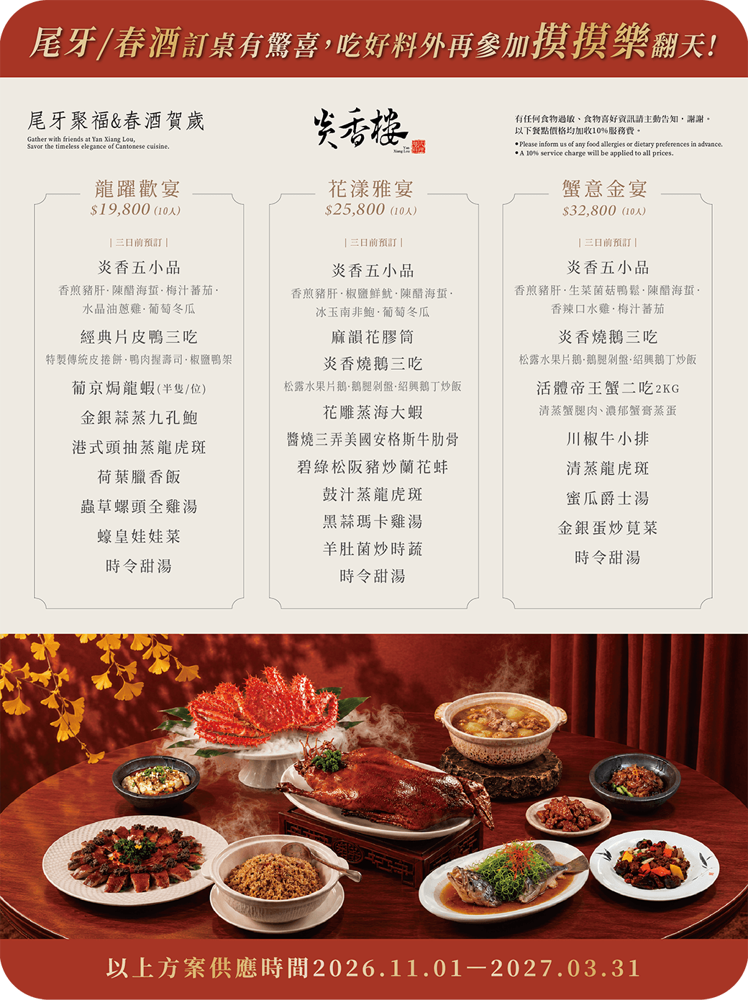

### 🥂 炎香樓粵式料理 | 台中尾牙春酒推薦 隱藏精誠路巷弄包廂桌宴 3款10人席加碼摸彩聚餐首選

年底將近，公司尾牙、春酒的場地怎麼挑？除了預算與人數，更在意的往往是菜色夠不夠體面、空間夠不夠私密、現場氣氛夠不夠熱鬧。炎香樓粵式料理藏身台中西區精誠八街的巷弄轉角，由世界廚神陳偉強領軍五星級主廚團隊，推出「尾牙聚福＆春酒賀歲桌宴」精選三款10人席，供應時間為 2026/11/01～2027/03/31，預訂任一方案即可獲得摸彩資格，吃好料之外還能一起玩「摸摸樂」。

訂桌有驚喜，吃好料再玩摸彩！

最早鳥訂桌➡️即日起—10/10預定完成，每桌贈紅酒一瓶\
\
早鳥訂桌➡️10/11—10/31預定完成，每桌贈凍檸茶一壺

預訂任一尾牙春酒方案，即享【摸彩資格】

🎬[尾牙小短片](https://www.youtube.com/shorts/DsDGHwTbWNQ)

預訂方案 / 摸彩次數

• 【龍躍歡宴 NT$19,800 / 抽 1 次】

• 【花漾雅宴 NT$25,800 / 抽 2 次】

• 【蟹意金宴 NT$32,800 / 抽 3 次】

📅 方案供應｜2026.11.01－2027.03.31
🎁 早鳥訂桌~再加碼送 1 抽！

明爐烤鴨全隻、燒味雙拼免費、波龍招牌菜 85 折，讓美味與好運一次滿桌！一席好宴，犒賞一年的努力；滿桌好味，迎接新一年的好運。
歡迎與我們聯繫，開一席好宴、享滿桌好味，讓好運隨席而來！

##### \-------------------------------

#### \
**文章目錄**

##### **• 【炎香樓粵式料理｜尾牙春酒重點整理】**

##### **• 【炎香樓粵式料理｜停車優惠】**

##### **• 【炎香樓粵式料理｜店面位置與包廂空間】**

##### **• 【炎香樓粵式料理｜三款桌宴價格一覽】**

##### **• 【炎香樓粵式料理｜龍躍歡宴】**

##### **• 【炎香樓粵式料理｜花漾雅宴】**

##### **• 【炎香樓粵式料理｜蟹意金宴】**

##### **• 【炎香樓粵式料理｜尾牙摸彩怎麼參加】**

##### **• 【炎香樓粵式料理｜訂位資訊】**

##### **• 【炎香樓粵式料理｜常見問題 FAQ】**

##### \
\
-------------------------------\
\
**【炎香樓粵式料理｜尾牙春酒重點整理】**

##### \
\
•  餐廳：炎香樓 YanXiang Lou｜台中西區粵式桌宴、私人訂製宴客

##### •  方案：龍躍歡宴NT$19,800／花漾雅宴 NT$25,800／蟹意金宴 NT$32,800（皆為10人份）

##### •  供應時間：2026/11/01～2027/03/31

##### •  預訂規定：三日前預訂

##### •  加碼：預訂任一方案即可參加摸彩，方案價位越高，抽獎次數越多

##### •  地址：台中市西區精誠八街12巷2號

##### •  預約專線：(04)2329-9968

##### \-------------------------------

##### 【炎香樓粵式料理｜停車優惠】

炎香樓位在精誠路巷弄內，附近巷道不好停車，建議把車停在附近的東興立體停車場再步行前往。從停車場步行到店約6分鐘（約400公尺），享免費停車2小時停車優惠。

\-------------------------------

#### 【炎香樓粵式料理｜店面位置與包廂空間】

炎香樓位在精誠八街12巷2號的轉角處，中式門樓搭配紅燈籠與盆栽，是辨識店面的特徵。店內空間融合中式古典與現代雅緻，一樓提供4至10人客席，二樓設有三間獨立包廂，適合10人以上宴席，也能依需求客製餐宴。炎香樓於2017年元月21日重裝登場，並引進全台首座直徑超過1米的大轉輪蒸籠，是許多人口中「巨籠宴」的代表。

對需要宴請同事、客戶或合作夥伴的企業來說，粵菜桌宴的好處是：菜色分量與節奏適合圍桌分享，片皮鴨、燒鵝、海鮮等大菜本身就有儀式感，而獨立包廂也讓致詞、敬酒與摸彩互動更自在。

\-------------------------------

#### 【炎香樓粵式料理｜龍躍歡宴】NT$19,800（10人）

•  炎香五小品：香煎豬肝、陳醋海蜇、梅汁蕃茄、水晶油蔥雞、葡萄冬瓜

•  經典片皮鴨三吃：特製傳統皮捲餅、鴨肉握壽司、椒鹽鴨架

•  葡京焗龍蝦（半隻/位）

•  金銀蒜蒸九孔鮑

•  港式頭抽蒸龍虎斑

•  荷葉臘香飯

•  蟲草螺頭全雞湯

•  蠔皇娃娃菜

•  時令甜湯

適合：部門聚餐、新創團隊或預算有限但想吃得體面的春酒。片皮鴨三吃加上每位半隻龍蝦，儀式感與飽足感兼具。

#### 【炎香樓粵式料理｜花漾雅宴】NT$25,800（10人）

•  炎香五小品：香煎豬肝、椒鹽鮮魷、陳醋海蜇、冰玉南非鮑、葡萄冬瓜

•  麻韻花膠筒

•  炎香燒鵝三吃：松露水果片鵝、鵝腿剁盤、紹興鵝丁炒飯

•  花雕蒸海大蝦

•  醬燒三弄美國安格斯牛肋骨

•  碧綠松阪豬炒蘭花蚌

•  豉汁蒸龍虎斑

•  黑蒜瑪卡雞湯

•  羊肚菌炒時蔬

•  時令甜湯

適合：想在預算與豪華感之間取得平衡的企業尾牙。燒鵝三吃、花膠、海鮮與牛肋骨，葷素與口味都兼顧，眾口易調。

#### 【炎香樓粵式料理｜蟹意金宴】NT$32,800（10人）

•  炎香五小品：香煎豬肝、生菜菌菇鴨鬆、陳醋海蜇、香辣口水雞、梅汁蕃茄

•  炎香燒鵝三吃：松露水果片鵝、鵝腿剁盤、紹興鵝丁炒飯

•  活體帝王蟹二吃(2KG)：清蒸蟹腿肉、濃郁蟹膏蒸蛋

•  川椒牛小排

•  清蒸龍虎斑

•  蜜瓜爵士湯

•  金銀蛋炒莧菜

•  時令甜湯

適合：宴請重要客戶、主管幹部或高規格感謝宴。整隻帝王蟹上桌的視覺效果，本身就是席間的話題。

※ 三款皆需三日前預訂。平均每位為桌價除以10人所得；服務費、酒水開瓶費等規定，請於預訂時向專人確認。

\-------------------------------

#### 【炎香樓粵式料理｜尾牙摸彩怎麼參加】

炎香樓把尾牙氣氛一起考慮進去：預訂任一方案即可獲得摸彩資格，而且依方案價位給予不同抽獎次數。

預訂方案 / 摸彩次數

龍躍歡宴 NT$19,800 / 抽 1 次

花漾雅宴 NT$25,800 / 抽 2 次

蟹意金宴 NT$32,800 / 抽 3 次

\-------------------------------

#### 【炎香樓粵式料理｜訂位資訊】

◎介紹店鋪：炎香樓粵式料理｜台中西區

◎地址：403 台中市西區公平里精誠八街12巷2號

◎電話：(04)2329-9968

◎LINE 官方帳號：[@mew1122i](https://lin.ee/6iuln3J)

◎營業時間：11:00～14:00／17:00～21:30（閉店時間；春節等特殊日期請訂位時確認）

◎消費提醒：務必事先預約訂位，尾牙春酒桌宴需三日前預訂

◎方案供應時間：2026/11/01～2027/03/31

◎[官方網站](https://yanxianglou.com.tw/)：https://yanxianglou.com.tw/

◎[菜單參考](https://yanxianglou.com.tw/menu-full.html)：https://yanxianglou.com.tw/menu-full.html

◎[外帶訂餐](https://yanxianglou.oddle.me/zh_TW)：https://yanxianglou.oddle.me/zh_TW

\-------------------------------

#### 【[炎香樓粵式料理｜常見問題 FAQ](https://yanxianglou.com.tw/faq.html)】

**Q：炎香樓的尾牙春酒桌宴多少錢？**

A：2027年供應三款，皆為10人份：龍躍歡宴 NT$19,800、花漾雅宴 NT$25,800、蟹意金宴 NT$32,800。

Q：尾牙春酒方案什麼時候供應？

A：供應時間為2026 年 11 月 1 日至 2027 年 3 月 31 日。

Q：需要提前多久預訂？

A：三款桌宴需三日前預訂。人數較多或需要客製菜色，建議更早洽詢。

Q：預訂尾牙春酒桌宴可以參加摸彩嗎？

A：可以。預訂任一方案即可獲得摸彩資格，龍躍歡宴抽1次、花漾雅宴抽2次、蟹意金宴抽3次。

Q：炎香樓有包廂可以辦尾牙嗎？

A：二樓設有三間獨立包廂，亦有適合10人以上宴席；包廂席次有限，建議提早預訂。

Q：炎香樓附近好停車嗎？

A：巷弄內不好停車，建議停在附近立體停車場步行前往。據部落客分享，東興立體停車場可享用餐免費停車2小時、步行約6分鐘，實際優惠請向店家確認。

Q：炎香樓有港式飲茶或吃到飽嗎？

A：沒有。炎香樓主打傳統粵菜，提供功夫菜、單點、宴客桌菜與客製專屬桌宴。

延伸閱讀

•  炎香樓巨籠宴

•  [炎香樓2027春節桌宴](https://yanxianglou.com.tw/news/2027%E5%9C%8D%E7%88%90%E5%9C%98%E5%9C%93-%E6%98%A5%E7%AF%80%E6%A1%8C%E5%AE%B4%E6%96%B9%E6%A1%88/)

•  [海鮮宴4人聚餐推薦](https://yanxianglou.com.tw/news/hai-yue-xiao-ju-long/)

•  炎香樓外帶訂餐

•  [台中西區美食網友推薦](https://www.instagram.com/yanxianglou/tagged/)

•  [炎香樓客製專屬桌宴](https://yanxianglou.com.tw/news/%E6%AF%8F%E4%B8%80%E6%A1%8C-%E9%83%BD%E6%98%AF%E5%B0%88%E5%B1%AC%E8%A8%82%E8%A3%BD/)

\    

#####
