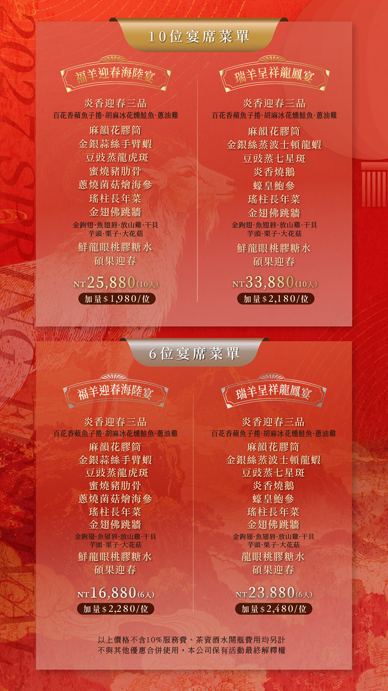
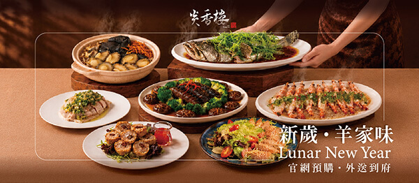

##### 過年最幸福的事，莫過於一家人團團圓圓，圍坐在餐桌旁，分享美食、聊聊近況，讓熟悉的笑聲與溫暖的陪伴，成為新年最美好的回憶。

##### 2027 羊年春節即將到來，圍爐怎麼吃才既有團圓氣氛、又不必自己準備一整桌？台中西區的炎香樓粵式料理，推出羊年春節桌宴：內用提供 6 人、10 人席，另有 10 人份外帶套組「羊年行大運」，供應日期為 2/5 除夕至 2/10 初五。內用桌宴有「福羊迎春海陸宴」與「瑞羊呈祥龍鳳宴」兩款，菜名取吉祥寓意，從迎春三品、花膠筒、金翅佛跳牆到長年菜，是一桌完整的粵式團圓年菜。

##### 今年春節，讓我們為您準備一桌豐盛佳餚，陪伴您與家人、親友共享團圓時光。

…………………………….

## 文章目錄

• 【炎香樓粵式料理｜2027春節桌宴重點整理】

• 【炎香樓粵式料理｜內用桌宴價格一覽】

• 【炎香樓粵式料理｜福羊迎春海陸宴】

• 【炎香樓粵式料理｜瑞羊呈祥龍鳳宴】

• 【炎香樓粵式料理｜羊年行大運外帶套組】

• 【炎香樓粵式料理｜內用外帶怎麼選】

• 【炎香樓粵式料理｜停車優惠】

• 【炎香樓粵式料理｜店面位置與包廂空間】

• 【炎香樓粵式料理｜訂位資訊】

• 【炎香樓粵式料理｜常見問題 FAQ】

…………………………….

## 【炎香樓粵式料理｜2027春節桌宴重點整理】

• 餐廳：炎香樓 YanXiang Lou｜台中西區粵式桌宴\
• 供應日期：2027/2/5除夕～2/10 初五\
• 內用桌宴：福羊迎春海陸宴、瑞羊呈祥龍鳳宴，各有 6 人席、10 人席\
• 外帶套組：羊年行大運外帶套組 NT$13,880（10人份），限定供應除夕至初五\
• 價格說明：內用價格不含 10% 服務費，茶資、酒水開瓶費另計\
• 地址：台中市西區精誠八街12巷2號\
• 預約專線：(04)2329-9968

…………………………….

## 【炎香樓粵式料理｜內用桌宴價格一覽】

方案  |  人數  |  價格  |  加量價

• 福羊迎春海陸宴10人	NT$25,880	NT$1,980(位)

• 瑞羊呈祥龍鳳宴10人	NT$33,880	NT$2,180(位)

• 福羊迎春海陸宴6人	NT$16,880	NT$2,280(位)

• 瑞羊呈祥龍鳳宴6人	NT$23,880	NT$2,480(位)

※ 以上價格不含 10%服務費，茶資、酒水開瓶費另計；不與其他優惠合併使用，活動最終解釋權歸店家所有。

…………………………….

## 【炎香樓粵式料理｜福羊迎春海陸宴】

「福羊迎春海陸宴」以海鮮與肉類並重，是家族圍爐最穩妥的選擇。

• 炎香迎春三品：百花香蘋魚子捲、胡麻冰花燻鮭魚、蔥油雞\
• 麻韻花膠筒\
• 金銀蒜絲手臂蝦\
• 豆豉蒸龍虎斑\
• 蜜燒豬肋骨\
• 蔥燒菌菇燴海參\
• 瑤柱長年菜\
• 金翅佛跳牆：金鉤翅、魚翅唇、放山雞、干貝、芋頭、栗子、大花菇\
• 鮮龍眼桃膠糖水\
• 碩果迎春

適合：三代同堂、6至10人的家庭圍爐，預算穩定又想吃到海參、佛跳牆等年菜代表。

## 【炎香樓粵式料理｜瑞羊呈祥龍鳳宴】

「瑞羊呈祥龍鳳宴」在同樣的年菜骨架上，把主菜升級為龍蝦、七星斑、燒鵝與鮑參，適合想把這一餐辦得更隆重的家庭或宴請長輩。

• 炎香迎春三品：百花香蘋魚子捲、胡麻冰花燻鮭魚、蔥油雞\
• 麻韻花膠筒\
• 金銀絲蒸波士頓龍蝦\
• 豆豉蒸七星斑\
• 炎香燒鵝\
• 蠔皇鮑參\
• 瑤柱長年菜\
• 金翅佛跳牆：金鉤翅、魚翅唇、放山雞、干貝、芋頭、栗子、大花菇\
• 鮮龍眼桃膠糖水\
• 碩果迎春

適合：重要家宴、宴請長輩或親友，想讓圍爐桌面更有份量。

## 【炎香樓粵式料理｜羊年行大運外帶套組】NT$13,880（10人）

不想出門、想在自家餐桌團圓的家庭，可以選擇外帶套組。「羊年行大運」供應10人份，除夕當日現煮熱菜，內容包含：

• 炎香迎春三品：百花香蘋魚子捲、胡麻冰花燻鮭魚、蔥油雞\
• 金銀蒜絲手臂蝦\
• 豆豉蒸龍虎斑\
• 蔥燒菌菇燴海參\
• 瑤柱長年菜\
• 蟲草鮑雞湯

外帶套組以10人份為單位供應，平均每位約 NT$1,388；想讓桌面更豐盛，可單點加購：

• 炎香燒鵝 | NT$3,680

• 金銀蒜絲蒸波龍 | NT$4,500\
（3隻/對半）

• 金翅佛跳牆 | NT$7,500\
（金鉤翅、魚翅唇、放山雞、干貝、芋頭、栗子、大花菇）

※ 以上價格不與其他優惠合併使用；取餐時間與預訂截止日，請洽專人確認。

…………………………….

#### ▶外帶套組 早鳥優惠：加碼送點數和贈禮回饋

越早預訂付清，加贈的點數越多；超早鳥另送私房辣醬禮盒二入組。

#### • 超早鳥優惠｜即日起－11/30：會員消費可累計27點，再加贈22點，最高累計49點，另贈價值$580私房辣醬禮盒二入組。

#### • 早鳥優惠｜12/1－12/19：會員消費可累計27點，再加贈18點，最高累計45點。

預購須在 1/15（五）前完成並全額繳清；加贈點數僅適用上述優惠期間。春節為特殊節慶活動，不得與其他優惠方案併用。

#### ▶會員點數累計與使用說明

會員消費每滿500元可累計1點，限內用及門市自取，外送恕不提供集點。

外帶年菜套組可累計27點，預購點數、贈送點數將於2027年2月5日統一入帳，可至會員集點後台查詢。

會員點數自發放日起365天後失效，請於期限內使用。

點數兌換方式及相關規則，請詳閱會員集點系統使用規範。

…………………………….

## 【炎香樓粵式料理｜內用外帶怎麼選】

• 想省去準備與收拾、享受餐廳服務：選內用桌宴。一樓提供4至10人客席，二樓設有三間獨立包廂。

• 想在家與家人團聚：選外帶套組「羊年行大運」，再視人數單點加購燒鵝、波士頓龍蝦或佛跳牆。

• 人數是 6 人或 10 人：優先選對應人數的桌宴，價格最划算；超過人數可選加量。

…………………………….

## 【炎香樓粵式料理｜停車優惠】

炎香樓位在精誠路巷弄內，附近巷道不好停車，建議把車停在附近【東興立體停車場】再步行前往。店內用餐可享東興立體停車場免費停車2小時，從停車場步行到店約6分鐘（約400公尺）。

…………………………….

## 【炎香樓粵式料理｜店面位置與包廂空間】

炎香樓位在精誠八街12巷2號的轉角處，中式門樓搭配紅燈籠與盆栽，是辨識店面的特徵。店內空間融合中式古典與現代雅緻，一樓提供4至10人客席，二樓設有三間獨立包廂，適合10人以上預約，最多可展開5桌，容納約55位貴賓，適合商務宴請、家族聚餐及各式慶祝場合。

…………………………….

## 【炎香樓粵式料理｜訂位資訊】

◎介紹店鋪：炎香樓粵式料理｜台中西區\
◎地址：403 台中市西區公平里精誠八街12巷2號\
◎電話：(04)2329-9968\
◎[LINE 官方帳號：@mew1122i](https://lin.ee/q8y7LYO)\
◎營業時間：11:00～14:00／17:00～21:30\
◎消費提醒：務必事先預約訂位\
◎供應日期：2027/2/5除夕～2/10 初五\
◎[官方網站：https://yanxianglou.com.tw/](https://yanxianglou.com.tw/)\
◎[菜單參考：https://yanxianglou.com.tw/menu-full.html](https://yanxianglou.com.tw/menu-full.html)\
◎[外帶訂餐：https://yanxianglou.oddle.me/zh_TW](https://yanxianglou.oddle.me/zh_TW)

…………………………….

## 【炎香樓粵式料理｜常見問題 FAQ】

Q：炎香樓2027春節桌宴有哪些方案？

A：內用有「福羊迎春海陸宴」與「瑞羊呈祥龍鳳宴」兩款，各有 6 人、10 人席；外帶有 10 人份的「羊年行大運」套組。

Q：春節桌宴的供應日期是？

A：2027 年 2 月 5 日（除夕）至 2 月 10 日（初五）。

Q：福羊迎春海陸宴和瑞羊呈祥龍鳳宴價格是多少？

A：福羊迎春海陸宴10 人 NT$25,880、6 人 NT$16,880；瑞羊呈祥龍鳳宴 10 人 NT$33,880、6 人 NT$23,880。價格不含 10% 服務費。

Q：人數超過6人或10人怎麼辦？

A：內用桌宴可以加量：福羊迎春海陸宴 10 人席每位 NT$1,980、6 人席每位 NT$2,280；瑞羊呈祥龍鳳宴 10 人席每位 NT$2,180、6 人席每位 NT$2,480。

Q：外帶套組「羊年行大運」包含什麼？多少錢？

A：NT$13,880（10人份），包含炎香迎春三品、金銀蒜絲手臂蝦、豆豉蒸龍虎斑、蔥燒菌菇燴海參、瑤柱長年菜與蟲草鮑雞湯。

Q：茶資、酒水要另外算嗎？

A：內用桌宴價格不含10% 服務費，茶資與酒水開瓶費另計。

Q：炎香樓附近好停車嗎？

A：巷弄內不好停車，建議停在附近立體停車場步行前往。據部落客分享，東興立體停車場可享用餐免費停車2小時、步行約6分鐘，實際優惠請向店家確認。

\-——————————

## 延伸閱讀

• [炎香樓尾牙春酒桌宴](https://yanxianglou.com.tw/news/%E5%B0%BE%E7%89%99-%E6%98%A5%E9%85%92-%E5%A5%BD%E5%AE%B4%E9%96%8B%E5%B8%AD/)\
• 炎香樓巨籠宴\
• [炎香樓外帶訂餐](https://yanxianglou.com.tw/news/%E7%82%8E%E9%A6%99%E6%A8%93%E7%B2%B5%E5%BC%8F%E6%96%99%E7%90%86-%E5%8F%B0%E4%B8%AD%E5%A4%96%E5%B8%B6%E5%B9%B4%E8%8F%9C%E6%8E%A8%E8%96%A6-2027%E7%BE%8A%E5%B9%B4%E8%A1%8C%E5%A4%A7%E9%81%8B10%E4%BA%BA%E4%BB%BD%E5%B9%B4%E8%8F%9C%E5%A5%97%E7%B5%84-%E8%B6%85%E6%97%A9%E9%B3%A5%E5%8A%A0%E8%B4%8822%E9%BB%9E-%E9%99%A4%E5%A4%95%E7%8F%BE%E5%81%9A%E7%86%B1%E8%8F%9C/)\
• [台中西區美食網友推薦](https://www.instagram.com/yanxianglou/tagged/)
